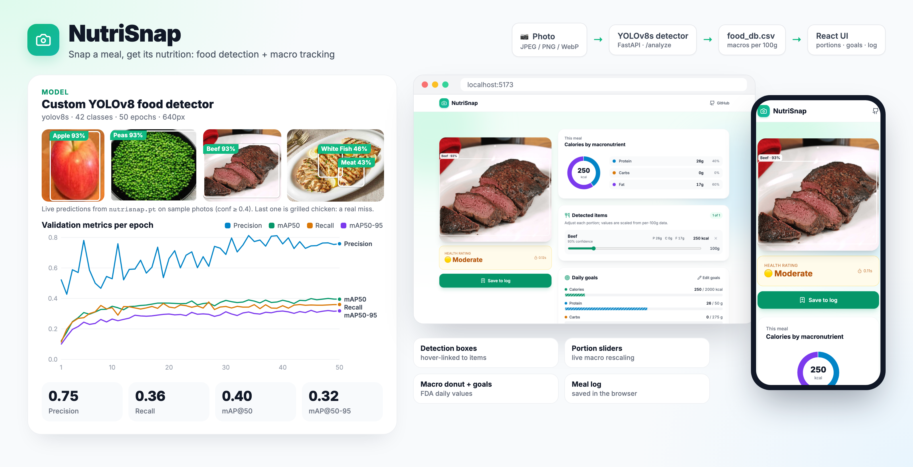
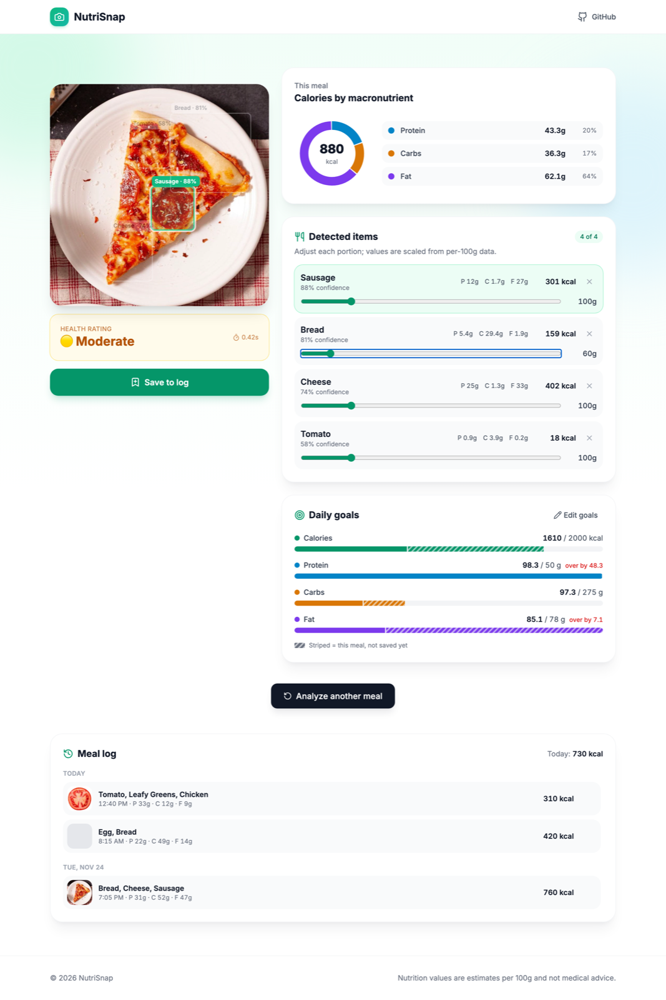
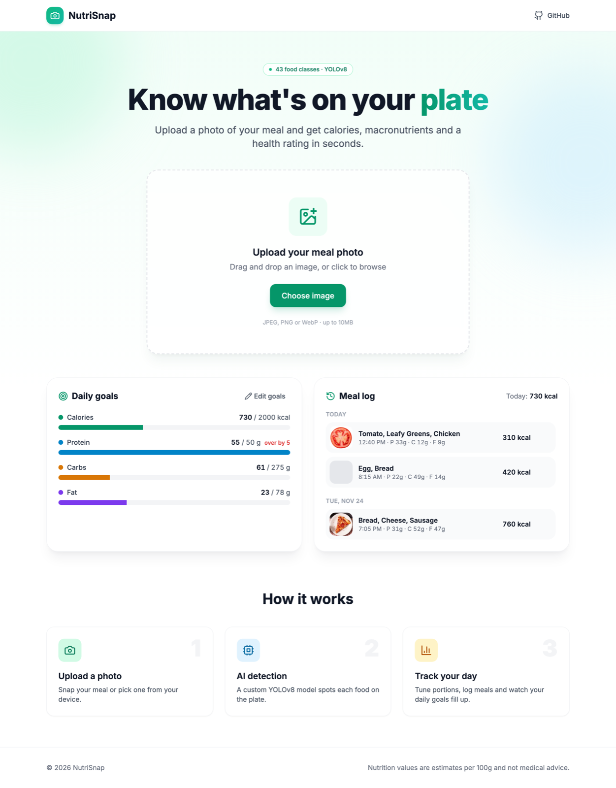
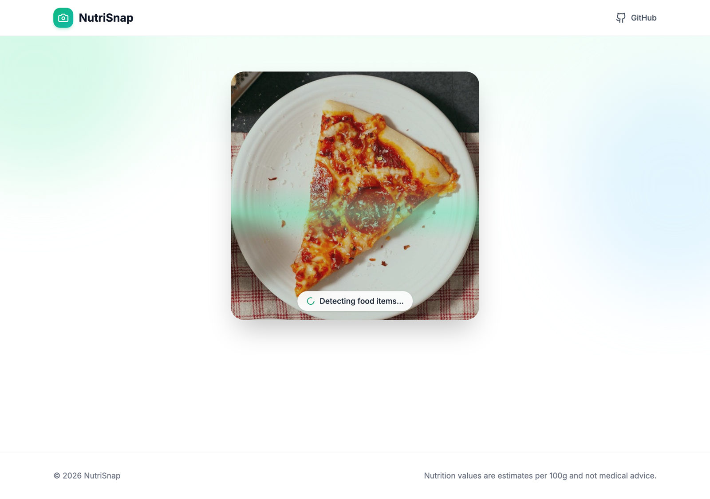
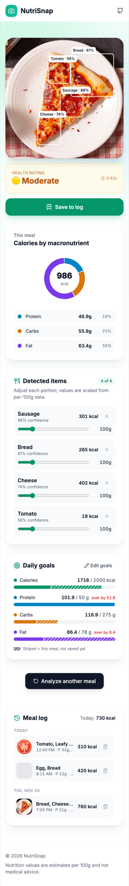
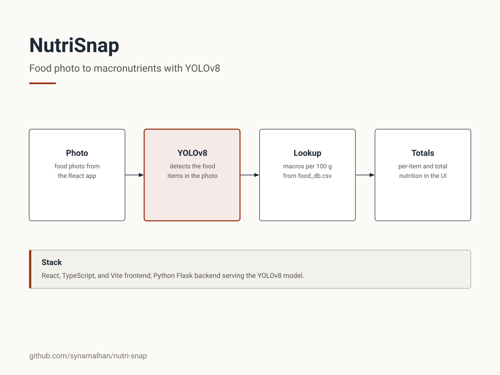

# 🍽️ NutriSnap Food Nutrition Database

Snap a photo of your meal and NutriSnap detects each food with a custom YOLOv8 model, then shows its calories, macros and a health rating.

<picture>
  <source media="(prefers-color-scheme: dark)" srcset="docs/overview-dark.png" />
  
</picture>

- **Detection boxes** drawn on your photo; hover a box or a row to link them
- **Portion sliders** per item (nutrition is scaled from per-100g values), plus remove/undo for misdetections
- **Macro donut** and **daily goal** progress (editable, FDA defaults)
- **Meal log** saved in your browser, grouped by day



| Home & meal log | Analyzing | Mobile |
| :---: | :---: | :---: |
|  |  |  |

## 🏗️ Architecture



This repository contains `food_db.csv`, a simple and structured database mapping common food items to their average macronutrient values per 100 grams. It is designed to work with object detection outputs from a custom-trained YOLOv8 model that recognizes 43 different food classes.

---

## 📄 CSV Structure

The `food_db.csv` file contains the following columns:

| Column     | Description                           |
| ---------- | ------------------------------------- |
| `name`     | Name of the food item (e.g., "Apple") |
| `calories` | Average calories per 100g             |
| `protein`  | Grams of protein per 100g             |
| `carbs`    | Grams of carbohydrates per 100g       |
| `fat`      | Grams of fat per 100g                 |

Example rows:

```
name,calories,protein,carbs,fat
Apple,52,0.3,14,0.2
Chicken,165,31,0,3.6
Rice,130,2.7,28,0.3
```

---

## 🧠 Model Training

The YOLOv8 model was trained to detect 43 food classes including fruits, vegetables, grains, meats, and dairy. You can access the **full model training pipeline in Google Colab** here:

🔗 **[Train YOLOv8 Food Detector – Colab Notebook](https://colab.research.google.com/drive/1Y5GDv7qWGL0madaaDbmPs7X2Bj17yo0x?usp=sharing)**

This notebook:

- Loads and visualizes your dataset
- Trains a custom YOLOv8 model using Ultralytics
- Evaluates precision, recall, and mAP
- Exports the final model (`best.pt`)

---

## 🧩 Integration

This CSV is used to enrich YOLO detection results with nutritional values in the NutriSnap app:

```python
# Example enrichment
detected_item = "Rice"
row = df[df["name"].str.lower() == detected_item.lower()].iloc[0]
print(row["calories"], row["protein"], row["carbs"], row["fat"])
```

---

## 📦 Usage

1. Place `food_db.csv` in your backend project directory.
2. Load it with `pandas` or any CSV reader.
3. Match YOLO-detected item names with the rows to get macros.

---

## 📬 Contributions

If you have additional food data or suggestions, feel free to open a PR or issue. We're aiming to expand this to more cuisines and global food items in future releases.
